# 💍 Pluto Accessories — Android App

> Aplikasi e-commerce aksesori berbasis Android dengan fitur lengkap untuk pelanggan dan admin.

**Dibuat oleh:** Arva Damar Fathoni  
**Kelas:** XII PPLG A | No. Absen: 6

---

## 📱 Tentang Aplikasi

**Pluto Accessories** adalah aplikasi belanja aksesori online berbasis Android yang menghubungkan pelanggan dengan produk-produk aksesori pilihan. Aplikasi ini dilengkapi dengan sistem manajemen admin yang komprehensif, sistem pembayaran QRIS, wallet digital, dan pelacakan pesanan real-time.

### 🛠️ Tech Stack

| Komponen | Teknologi |
|----------|-----------|
| Mobile App | Android (Kotlin) |
| Backend API | PHP (REST API) |
| Database | MySQL |
| Pembayaran | QRIS / Wallet |
| Build System | Gradle (Kotlin DSL) |

---

## 📋 Alur Penggunaan Aplikasi

## 👤 A. ROLE USER / CUSTOMER

---

### 1. 📝 Tahap Registrasi & Login

Pengguna baru dapat melakukan pendaftaran melalui **RegisterActivity**.

- User memasukkan data lengkap seperti nama, email, password, alamat, dan nomor HP
- Setelah registrasi, sistem menyimpan role sebagai `'user'`
- User yang sudah terdaftar dapat login melalui **LoginActivity** untuk masuk ke **MainActivity**

<p align="center">
  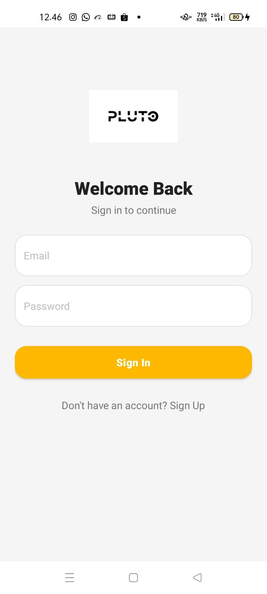
  &nbsp;&nbsp;
  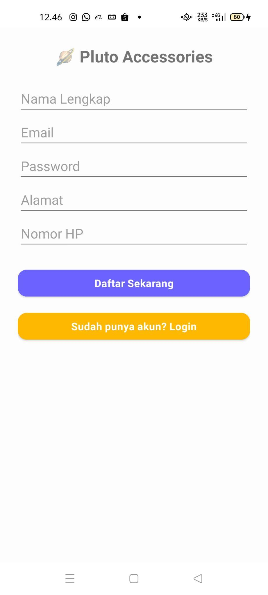
</p>
<p align="center"><em>Halaman Register & Login</em></p>

---

### 2. 🛍️ Tahap Browsing Produk

User dapat menjelajahi semua produk yang tersedia.

- User melihat banner promo, kategori produk, dan melakukan pencarian
- Kategori dapat dipilih dan hasil otomatis terfilter
- Notifikasi ditampilkan melalui **NotificationsActivity**

<p align="center">
  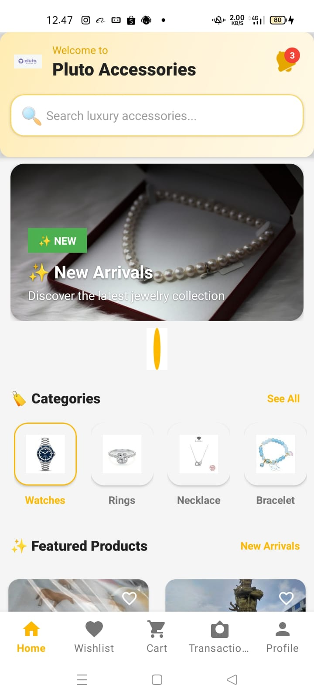
</p>
<p align="center"><em>Halaman Beranda / Browse Produk</em></p>

---

### 3. ❤️ Tahap Detail & Wishlist

User dapat melihat detail produk dan menyimpannya ke wishlist.

- User dapat melihat detail produk, menambah produk ke wishlist atau keranjang
- Wishlist dapat dilihat pada **WishlistActivity** dan produk bisa ditambahkan langsung ke cart

<p align="center">
  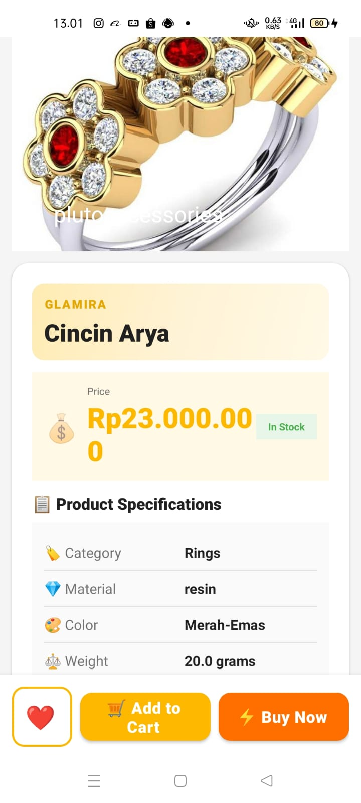
  &nbsp;&nbsp;
  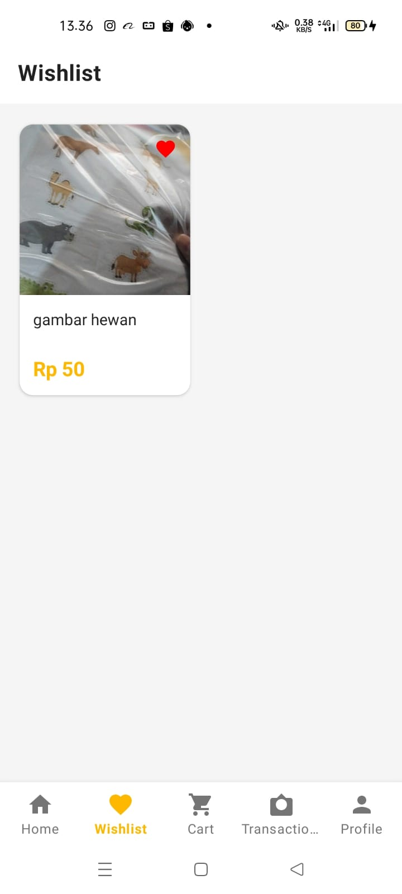
</p>
<p align="center"><em>Halaman Detail Produk & Wishlist</em></p>

---

### 4. 🛒 Tahap Belanja (Shopping)

User dapat melakukan proses pembelian dari keranjang hingga pembayaran.

- User mengelola keranjang belanja di **CartActivity**
- Checkout dilakukan dengan verifikasi data, memilih metode pembayaran, dan konfirmasi pesanan
- User dapat melakukan upload bukti pembayaran pada **QrisPaymentActivity**

<p align="center">
  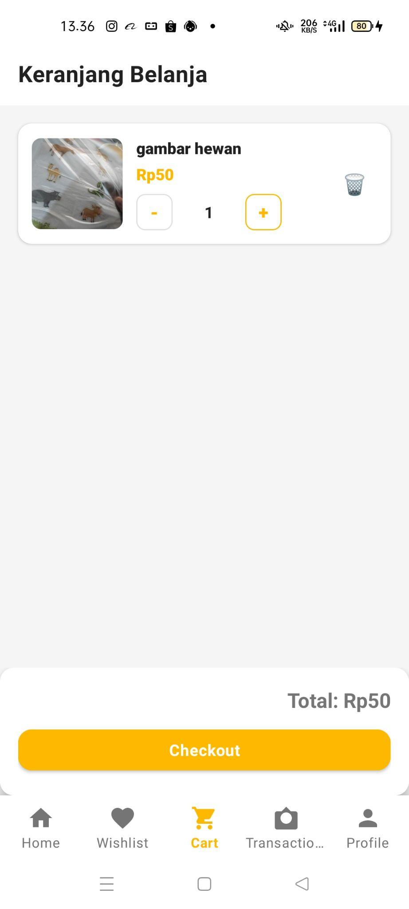
  &nbsp;&nbsp;
  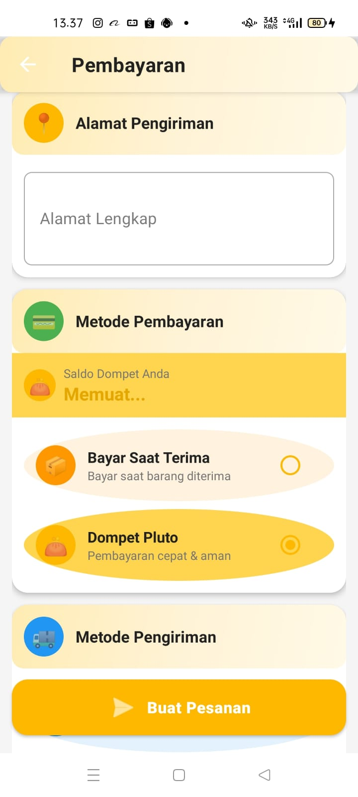
  &nbsp;&nbsp;
  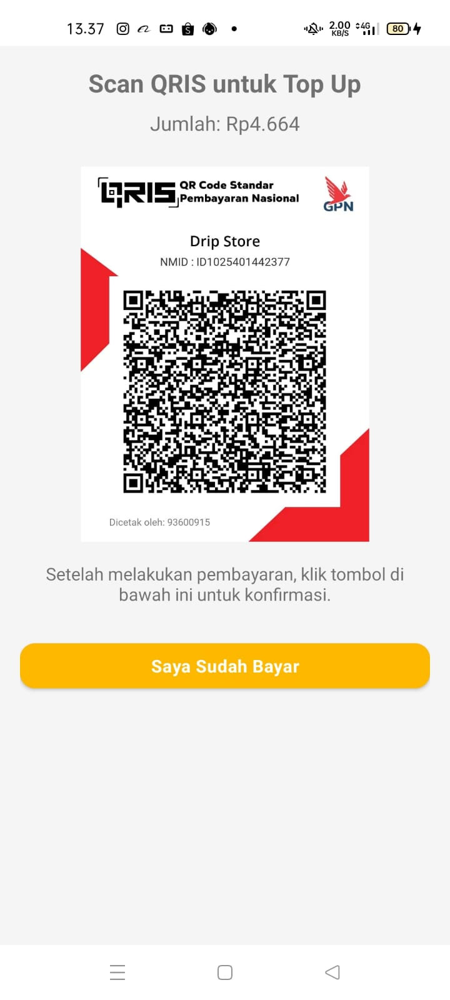
</p>
<p align="center"><em>Keranjang Belanja, Checkout & Pembayaran QRIS</em></p>

---

### 5. 📦 Tahap Tracking Pesanan

User dapat memantau status pesanan secara real-time.

- **OrderHistoryActivity** menampilkan pesanan berdasarkan status
- **OrderDetailActivity** menyediakan detail pesanan, termasuk timeline, resi, dan invoice

<p align="center">
  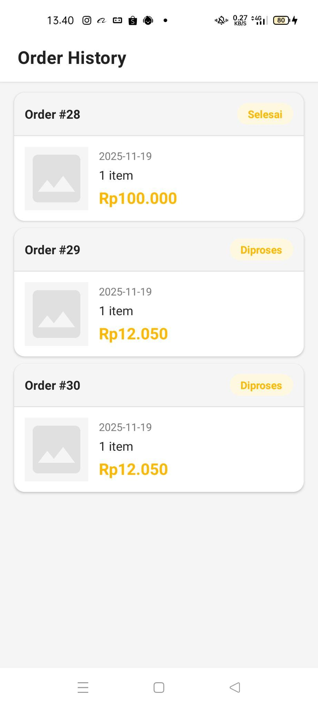
</p>
<p align="center"><em>Halaman Riwayat & Detail Pesanan</em></p>

---

### 6. 💳 Tahap Transaksi & Wallet

User memiliki akses ke riwayat transaksi dan fitur dompet digital.

- **TransactionsActivity** menampilkan seluruh riwayat transaksi
- **WalletActivity** memungkinkan top up, melihat saldo, dan menggunakan wallet sebagai metode pembayaran

<p align="center">
  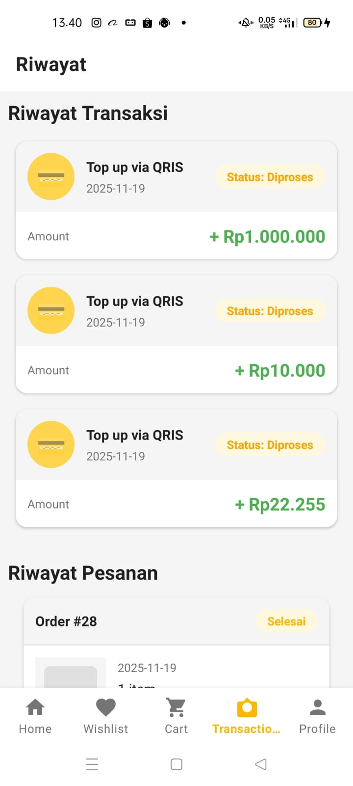
</p>
<p align="center"><em>Halaman Transaksi & Wallet</em></p>

---

### 7. 👤 Tahap Profil & Pengaturan

User dapat mengelola akun dan informasi personalnya.

- User mengelola profil, mengganti password, melihat riwayat pesanan, dan melakukan logout

<p align="center">
  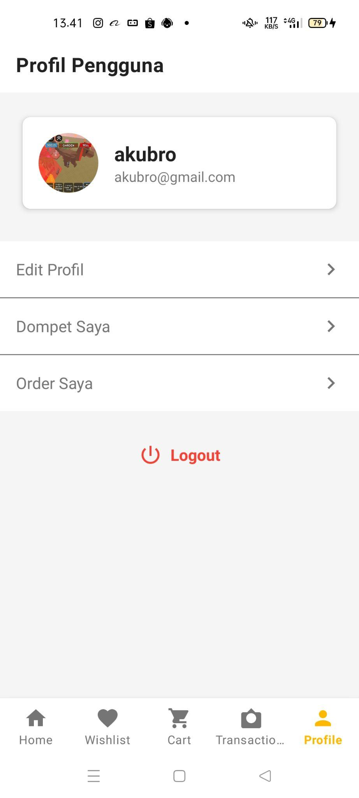
  &nbsp;&nbsp;
  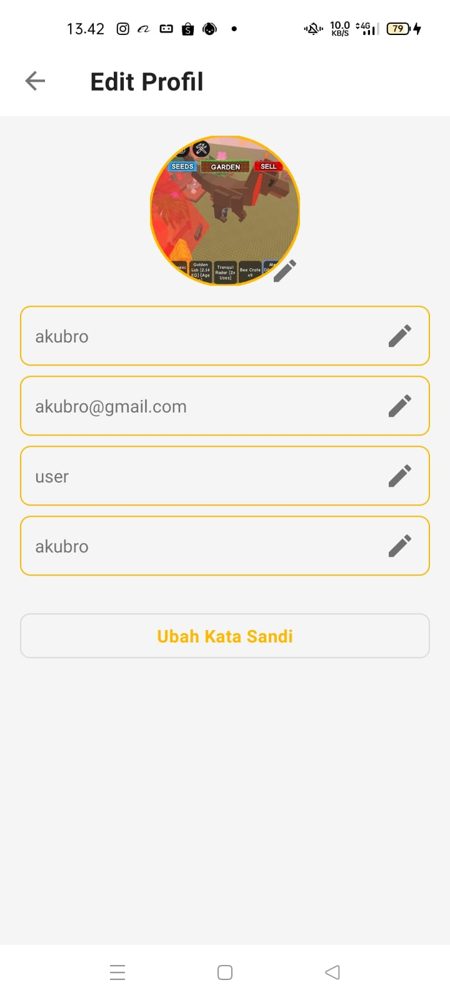
</p>
<p align="center"><em>Halaman Profil & Edit Profil</em></p>

---

## 🔧 B. ROLE ADMIN

---

### 1. 🔐 Tahap Login Admin

- Admin login menggunakan akun dengan role `'admin'`
- Setelah login, admin diarahkan ke **AdminDashboardActivity**

<p align="center">
  
</p>
<p align="center"><em>Halaman Login Admin</em></p>

---

### 2. 🏠 Dashboard Admin

Admin memiliki akses ke panel kontrol lengkap.

- Admin melihat informasi akun dan navigasi ke menu manajemen
- Menu mencakup produk, user, pesanan, transaksi, banner, notifikasi, dan pengaturan aplikasi

<p align="center">
  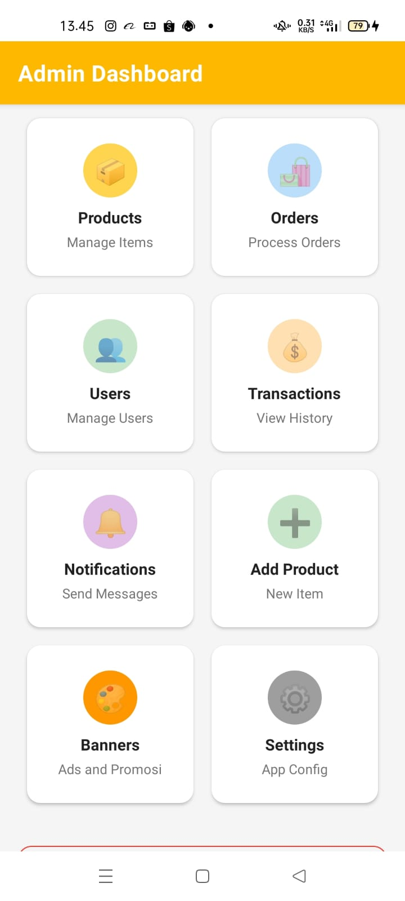
</p>
<p align="center"><em>Dashboard Admin</em></p>

---

### 3. 📦 Kelola Produk

Admin dapat mengelola seluruh katalog produk.

- Admin dapat menambah, mengedit, menghapus, dan mencari produk
- Tambah produk meliputi upload foto, input harga, kategori, deskripsi, dan stok

<p align="center">
  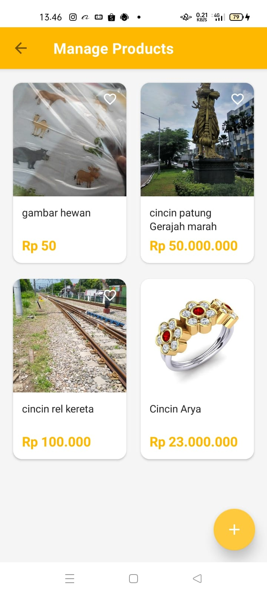
  &nbsp;&nbsp;
  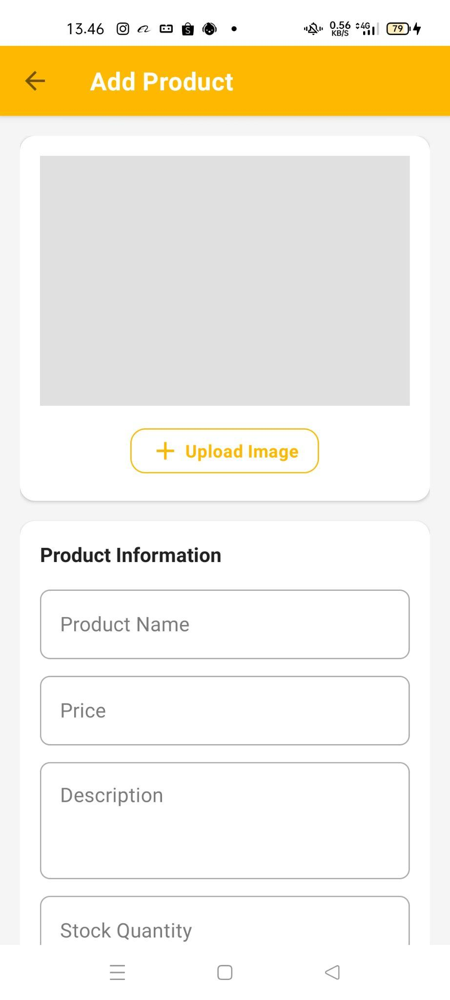
  &nbsp;&nbsp;
  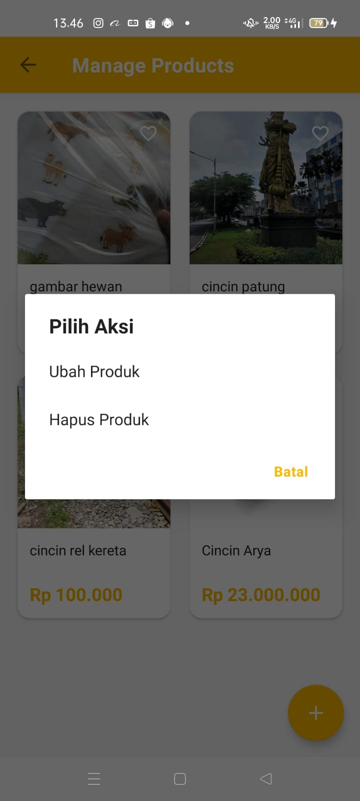
</p>
<p align="center"><em>Manajemen Produk (List, Tambah, Edit)</em></p>

---

### 4. 👥 Kelola Pengguna

Admin dapat memantau dan mengelola semua akun pengguna.

- Admin melihat daftar semua user, melakukan filter, melihat detail, dan mengubah status user

<p align="center">
  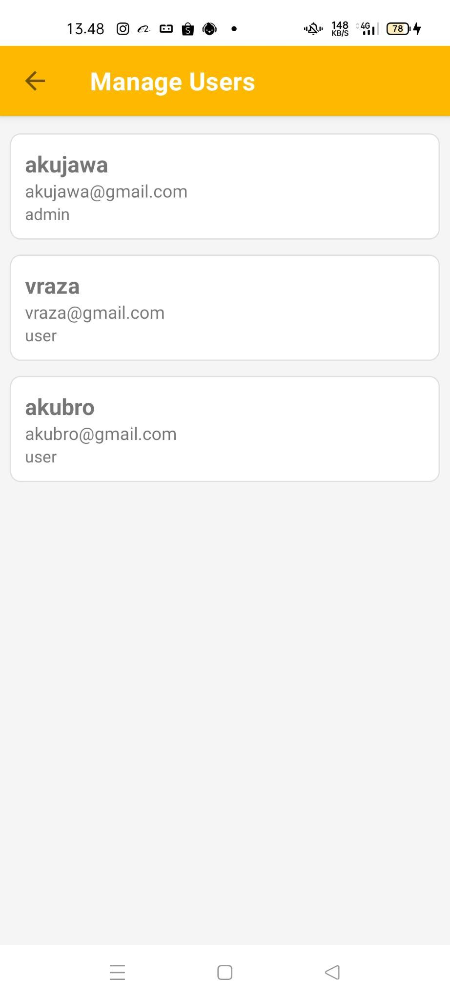
</p>
<p align="center"><em>Halaman Manajemen Pengguna</em></p>

---

### 5. 🚚 Kelola Pesanan

Admin memproses dan memantau semua pesanan yang masuk.

- Admin memproses pesanan dari `pending` hingga `completed`
- Admin dapat memverifikasi pembayaran, memasukkan resi, dan membatalkan pesanan

<p align="center">
  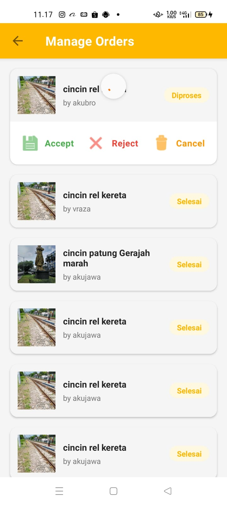
</p>
<p align="center"><em>Halaman Manajemen Pesanan</em></p>

---

### 6. 💰 Kelola Transaksi

Admin memverifikasi semua transaksi keuangan.

- Admin memverifikasi transaksi, menerima/menolak pembayaran, dan melakukan filter transaksi

<p align="center">
  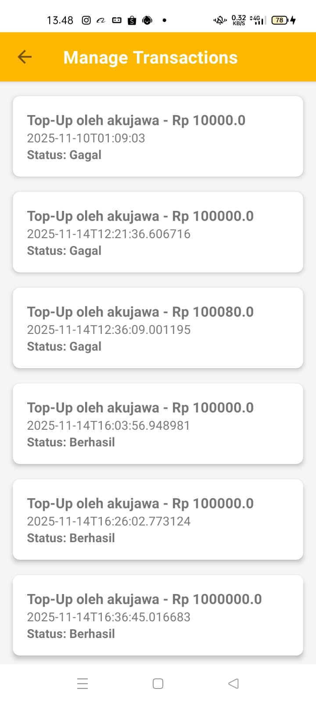
</p>
<p align="center"><em>Halaman Manajemen Transaksi</em></p>

---

### 7. 🔔 Kelola Notifikasi

Admin dapat mengirim notifikasi ke pengguna.

- Admin mengirim notifikasi ke seluruh user atau target tertentu
- Notifikasi dapat berisi promo, informasi sistem, atau update pesanan

<p align="center">
  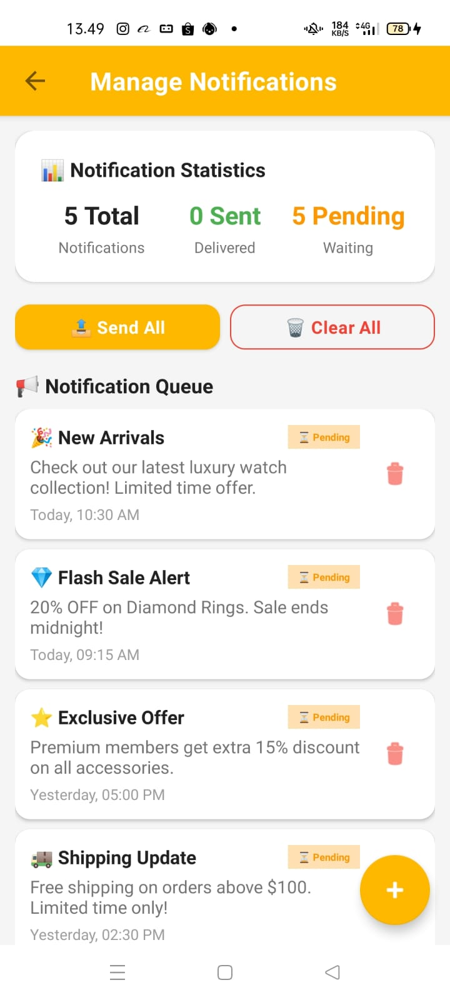
</p>
<p align="center"><em>Halaman Manajemen Notifikasi</em></p>

---

### 8. 🖼️ Kelola Banner

Admin mengatur banner promosi di halaman utama.

- Admin mengatur banner promo pada halaman utama user
- Banner dapat diaktifkan/nonaktifkan serta dijadwalkan

<p align="center">
  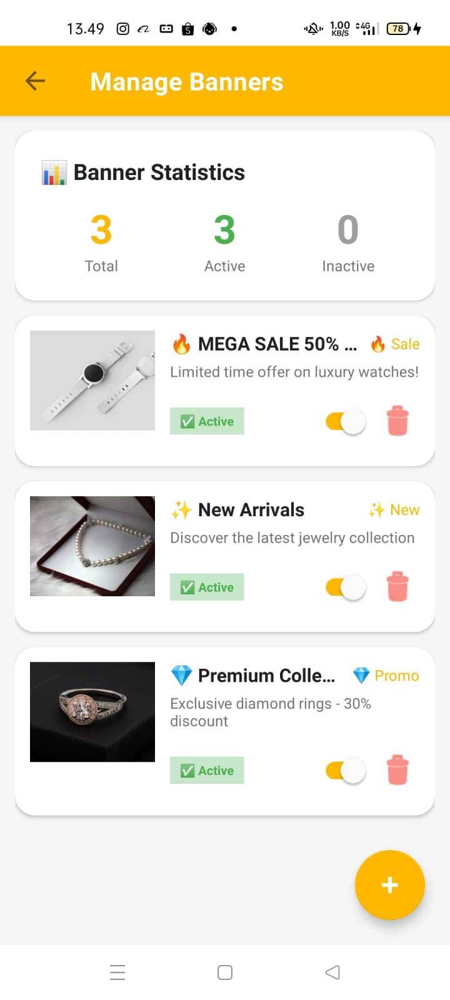
</p>
<p align="center"><em>Halaman Manajemen Banner</em></p>

---

### 9. ⚙️ Pengaturan Aplikasi

- Pengaturan tema dan konfigurasi aplikasi dapat diatur dari menu ini

<p align="center">
  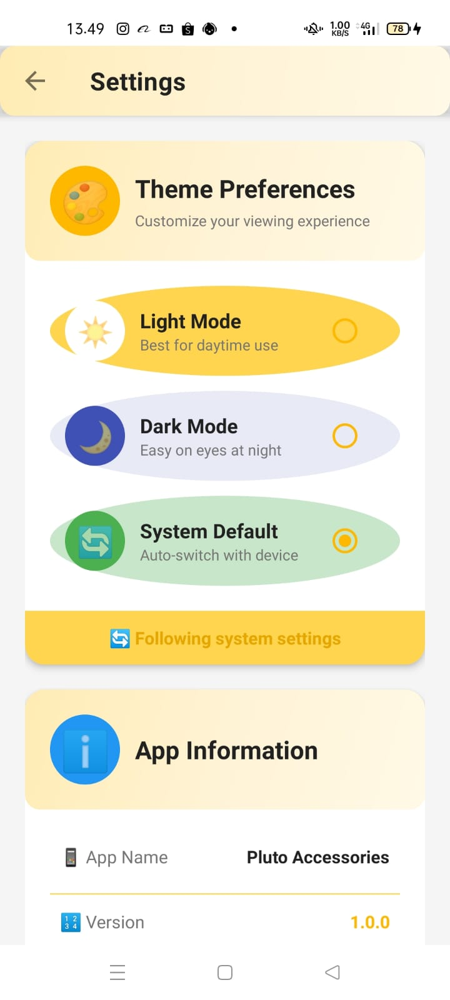
</p>
<p align="center"><em>Halaman Pengaturan Aplikasi</em></p>

---

### 10. 🚪 Logout Admin

- Admin dapat keluar dari akun dan session akan dibersihkan

---

## 📁 Struktur Project

```
plutoaccessories/
├── app/
│   └── src/main/
│       ├── java/com/example/plutoaccessories/
│       │   ├── LoginActivity.kt
│       │   ├── RegisterActivity.kt
│       │   ├── MainActivity.kt
│       │   ├── CartActivity.kt
│       │   ├── CheckoutActivity.kt
│       │   ├── WishlistActivity.kt
│       │   ├── OrderHistoryActivity.kt
│       │   ├── WalletActivity.kt
│       │   ├── ProfileActivity.kt
│       │   ├── AdminDashboardActivity.kt
│       │   └── ... (dan banyak lagi)
│       └── res/
│           ├── layout/   → semua file XML layout
│           └── drawable/ → ikon dan gambar
├── pluto_api/            → Backend PHP API
│   ├── db_connect.php
│   ├── login_user.php
│   ├── register_user.php
│   ├── get_products.php
│   ├── insert_order.php
│   ├── wallet.php
│   └── ... (dan banyak lagi)
└── screenshots/          → Screenshot tampilan aplikasi
```

---

## 🚀 Cara Menjalankan

### Android App
1. Clone repository ini
2. Buka dengan **Android Studio**
3. Sync Gradle
4. Jalankan di emulator atau device fisik (min. Android 7.0)

### Backend API
1. Upload folder `pluto_api/` ke server PHP (XAMPP / hosting)
2. Import database MySQL
3. Update `db_connect.php` dengan konfigurasi database kamu
4. Update base URL di Android app

---

## 📄 Lisensi

Project ini dibuat untuk keperluan tugas sekolah — XII PPLG A.
